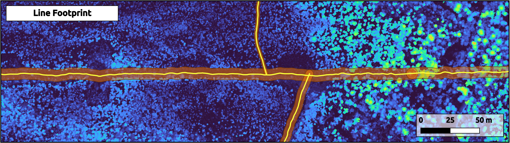
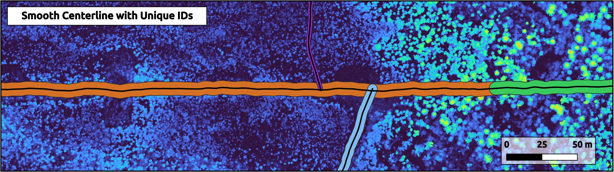
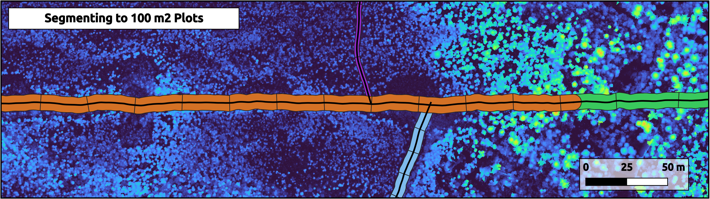
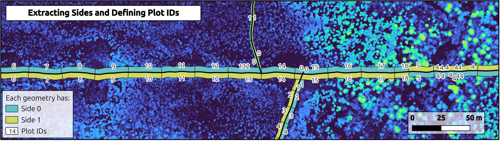
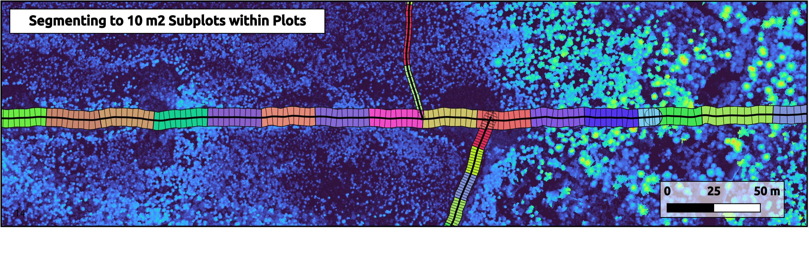

# 🌿 SegLine: Geospatial Pipeline for Segmentation of Linear Disturbances

**SegLine** is a component of a reproducible pipeline for geospatial analysis of recovery across linear disturbances, including seismic lines - oil and gas exploration corridors. This tool is specifically designed to segment the footprint of linear disturbances into plots and subplots—units used for attribute extraction and for building decision trees to assess recovery status.

The pipeline is implemented in **Python** and uses tools such as **GeoPandas**, **Shapely**, and **Hydra** for efficient geospatial processing and flexible configuration management. It supports **parallel execution** and **modular design**, making it adaptable to a variety of geographic datasets.

SegLine represents the **second step** in the broader workflow for assessing recovery on linear disturbances. The **first step** involves the [Forest Line Mapper (FLM)](https://github.com/appliedgrg/flm), a set of scripts used to delineate the linear footprint from coarse or inaccurate prior layers. These source layers vary by jurisdiction—for instance, Alberta relies on the Human Footprint Inventory (ABMI), while British Columbia uses the SLU dataset.

SegLine requires fixed-width **footprint** and **centerline** layers, typically generated by FLM. Its output includes the footprint segmented into **plots** and **subplots**, with consistent and unique IDs assigned to each line, plot, and subplot. Plots and subplots can be cut either to a **fixed area** or at a **fixed length** along the line (see [Two segmentation modes](#-two-segmentation-modes)).

A subsequent module for **attribute extraction** (e.g., vegetation cover, seedling density, trail presence) is under development and will be released soon.

---

## 🚀 Quick Start

Requires Python 3.10+.

1. Clone the repository:
   ```bash
   git clone https://github.com/IrinaTerentieva/SegLine.git
   cd SegLine
   ```

2. Install dependencies:
   ```bash
   pip install -r requirements.txt
   ```

3. Run on the included sample data (8 seismic lines with several intersections, 1 × 1 km):
   ```bash
   python run_fixed_area.py      # plots and subplots of a fixed area
   python run_fixed_length.py    # plots and subplots at a fixed spacing along the line
   ```

Always run from the repository root. Each mode takes a few seconds on the sample. Results are written next to the inputs in `sample_data/` (see [Outputs](#-outputs)).

Reference results from both modes are included in `sample_data/example_output/fixed_area/` and `sample_data/example_output/fixed_length/`. Open them in QGIS to see what to expect, or compare them with your own run. `UniqueID` values are random, so they differ between runs.

## 🔀 Two Segmentation Modes

| | **Fixed area** (`run_fixed_area.py`) | **Fixed length** (`run_fixed_length.py`) |
|---|---|---|
| **Plots** | Target area, e.g. 100 m² (`split_to_plots.plot_area`) | Fixed spacing along the centerline, e.g. every 50 m (`split_to_plots.perpendicular_spacing`) |
| **Subplots** | Target area (`split_to_subplots.subplot_area`) | Fixed spacing, e.g. every 10 m (`split_to_subplots.perpendicular_spacing`) |
| **Plot size on wide vs. narrow lines** | Same area; plots get shorter as the line gets wider | Same length; plot area grows with line width |
| **Centerline cleaning** | Yes: removes duplicate, subset and overlapping centerlines | Not yet |
| **Centerline smoothing** | Optional (`smoothing.perform_smoothing`) | Not supported |
| **Code** | `src/fixed_area/` | `src/fixed_length/` |
| **Use when** | Plots must be comparable by area (e.g. stocking or density per m²) | Plots must line up with distance along the line (e.g. matching field transects) |

On the sample data with the default config, fixed area produces about 1,800 subplots of ~10 m², and fixed length about 1,000 subplots of ~20 m².

## 🧩 Pipeline Steps

Both modes follow the same sequence. Steps 2–3 run in fixed-area mode only.

1. **Assign Unique IDs**  
   Assigns a consistent `UniqueID` to each footprint polygon and links it with the corresponding centerline by interpolating sample points along the centerline.



2. **Clean Centerlines** *(fixed area)*  
   Removes duplicate centerlines and centerlines that are subsets of longer ones, and trims partial overlaps.

3. **Smooth Centerlines** *(optional, fixed area)*  
   Reduces sharp angles in the centerlines using buffer-based smoothing to improve the quality of later segmentation (`src/common/smooth_centerline.py`).



4. **Split to Plots**  
   Generates perpendiculars along the centerline and segments the footprint into **plots**, either of a target area (fixed area) or at a fixed spacing (fixed length).



5. **Split to Sides**  
   Identifies side pairs in each plot (based on orientation and shared edge points), and assigns side labels and plot IDs.



6. **Split to Subplots**  
   Each side is further split into **subplots** and each is assigned a `subplot_id` for fine-scale analysis. Subplots smaller than `min_area_fraction × plot_area` are merged into their neighbours.



## 📊 Outputs

All outputs are GeoPackages written to the **same folder as the input footprint and centerline**. File names are built from the input names. For inputs `footprint.gpkg` and `centerline.gpkg`:

| Step | Fixed area | Fixed length |
|---|---|---|
| 1. IDs | `footprint_footprint_ID.gpkg`, `centerline_centerline_ID.gpkg` | same |
| 4. Plots | `footprint_footprint_ID_segments<A>m2.gpkg` (A = real median area per side) | `footprint_footprint_ID_segments<S>m.gpkg` (S = spacing) |
| 5. Sides | `footprint_sides.gpkg` | `footprint_footprint_ID_segments<S>m_sides.gpkg` |
| 6. Subplots | `footprint_subplots<a>m2.gpkg` | `footprint_footprint_ID_segments<S>m_subplots<s>m.gpkg` |

The final subplot layer is the one to use downstream. Key columns:
- `UniqueID`: line (footprint polygon) ID
- `side`: side of the centerline
- `plot_id`, `subplot_id`: plot and subplot IDs within a line
- `area`, `length`, `perimeter`, `plot_area`, `subplot_area`: geometry measures (m, m²)

In fixed-area mode, the clean-centerlines step overwrites `centerline_centerline_ID.gpkg` in place. That file is regenerated by step 1 on every run.

## 📂 Using Your Own Data

You need a **footprint** polygon layer and a matching **centerline** layer in a projected CRS (metres). The footprint layer needs a width column (metres), named in `dataset.width_column`.

Either edit `dataset:` in `src/config/workflow.yaml`, or keep your paths out of version control by creating **`src/config/local/private.yaml`**. That file is git-ignored and, when present, overrides `workflow.yaml`:

```yaml
dataset:
  ground_footprint: "/data/my_project/footprint.gpkg"
  centerline: "/data/my_project/centerlines.gpkg"
  width_column: "width"
```

## ⚙️ Configuration

All settings are in `src/config/workflow.yaml` (loaded with Hydra via `src/config/config.yaml`).

**`dataset`** (both modes)

| Key | Meaning |
|---|---|
| `ground_footprint`, `centerline` | Paths to the footprint polygons and centerlines (`.gpkg` or `.shp`) |
| `ground_footprint_layer`, `centerline_layer` | Layer name inside a multi-layer GeoPackage, or `null` |
| `width_column` | Footprint column with line width in metres |
| `unique_id_length` | Length of the random `UniqueID` |
| `debug` | Extra logging |

**`smoothing`** (fixed area, optional)

| Key | Meaning |
|---|---|
| `perform_smoothing` | Run the smoothing step |
| `use_assign_id_output` | Smooth the centerline written by step 1 (otherwise use `smoothing.centerline`) |
| `angle_threshold` | Vertices with a sharper angle are smoothed (lower = more smoothing) |
| `buffer_distance` | Buffer size used for smoothing (larger = stronger) |
| `num_workers` | Parallel processes |

**`split_to_plots`**

| Key | Mode | Meaning |
|---|---|---|
| `plot_area` | both | Fixed area: target plot area (m²). Both modes: reference area for merging small subplots |
| `perpendicular_spacing` | fixed length | Distance between plot boundaries along the line (m) |
| `extension_distance` | both | How far centerline ends are extended before cutting (m) |
| `max_splitter_length_buffer` | both | Currently not used: cut length is set from the line width (width + 10 m, or 15 m if width is missing) |
| `num_workers` | both | Parallel processes |

**`split_to_side`**

| Key | Mode | Meaning |
|---|---|---|
| `splitting_method` | fixed area | Keep `"area"`. It only tells the sides step which plot file to read; it does **not** switch modes |
| `min_area` | fixed length | Pieces smaller than this (m²) are dropped |

**`split_to_subplots`**

| Key | Mode | Meaning |
|---|---|---|
| `subplot_area` | both | Fixed area: target subplot area (m²). Fixed length: stored as an attribute only |
| `perpendicular_spacing` | fixed length | Distance between subplot boundaries along the line (m) |
| `min_area_fraction` | both | Subplots smaller than `min_area_fraction × plot_area` are merged |
| `use_smooth_centerline` | fixed area | Use the smoothed centerline if smoothing ran |
| `max_splitter_length_buffer` | both | Currently not used (see `split_to_plots`) |
| `num_workers` | both | Parallel processes |

## ⚠️ Known Limitations

- **Fixed-length mode does not yet run centerline cleaning or smoothing.** Duplicate or overlapping centerlines should be fixed before running it.
- **pandas 3 is not supported yet** (`requirements.txt` pins `pandas<3`).

## 🤝 Acknowledgments

**Funding**

This repository is part of the Boreal Ecosystem Recovery and Assessment (BERA) project (www.bera-project.org), and was supported by a Natural Sciences and Engineering Research Council of Canada Alliance Grant (ALLRP 548285-19) in conjunction with Alberta-Pacific Forest Industries, Alberta Biodiversity Monitoring Institute, Alberta Environment and Protected Areas, Alberta Innovates, Canadian Natural Resources Ltd., Cenovus Energy, ConocoPhillips Canada, Imperial Oil Ltd., and Natural Resources Canada.

**Contributions**

Conceptualization: Irina Terenteva (IT)

Coding: IT

Data Curation: N/A

Other Contributions: N/A


Irina Terenteva developed this repository while serving a joint role with the **Applied Geospatial Research Group** at the University of Calgary (https://www.appliedgrg.ca/) and **Falcon & Swift Geomatics** (https://www.falconandswift.ca/).  The support of both organizations is acknowledged.

## 📄 License

This project is licensed under the Apache License 2.0 - see the [LICENSE](LICENSE) file for details.
